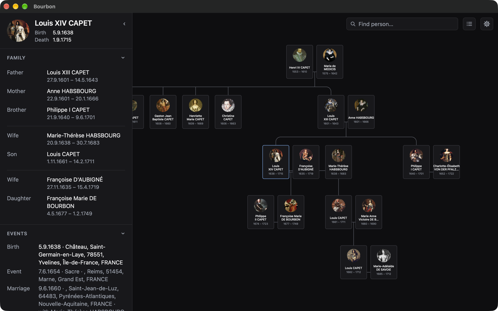

# &ensp;Sukulinja

Most family trees stop at "source: Mikkeli rippikirja 1790–1796, p. 214". Sukulinja goes the last step: click the source and the page opens, the entry boxed, the household transcribed, everyone it names cited to it.

It's a genealogy editor for people working with Finnish church books. The tree is drawn as an hourglass chart, with portraits, around whoever you're looking at, and everything in it can be edited: people, families, facts, and the sources each fact rests on. The scans come from Astia, the National Archives' digital archive. Sukulinja is the tree's master copy, and GEDCOM 7 is the way out whenever you like.



## Features

### The tree

An hourglass chart centred on anyone: bloodline ancestors above, descendants below, siblings, half-siblings and step-families on the rows where they belong. Moving to another person animates the change, and the view is kept in the URL. Add parents, spouses, children and siblings from a card's menu, link someone already in the tree, or move a child to the right parents. The app won't let a deletion cut the tree in two.

### Facts and sources

Births, marriages, residences and the rest are edited in the person panel, each with the citations that support it. A church-book entry records what its book says, and offers to add or correct the facts it backs up.

### Church books

Sukulinja finds a parish's volumes in Astia and links each church-book citation to the scan of its page, estimating the image from the page number when it doesn't know it. In the scan viewer you step through the volume, draw a box around the entry, transcribe it and cite it for the child, the parents and the godparents at once. The _Volumes_ view lists the books your tree works in, the volumes that should hold a person's baptism, childhood, marriages and burial, and what's downloaded; volumes can be downloaded whole, or offloaded to an external drive.

### Photos

Every picture in the dataset, with the people tagged in it. Tag someone by drawing a box, and use it as their portrait on the chart.

### Keeping track

_Changes_ lists everything done to the dataset, newest first, each a way back to where it happened. _Reminders_ keep what to come back to, on a person, a scan or nothing in particular.

### In and out

Start a new tree from its first person, or import a GEDCOM, a GEDZIP or a MyHeritage export. Export a GEDZIP (GEDCOM 7 with photos) as a backup or to take the tree elsewhere. A House of Bourbon demo dataset is included.

## Experimental: Claude

These use Claude through your own Anthropic API key, set in Settings. They're experiments: expect rough edges, and check what they find before you rely on it. Nothing they do is written without you confirming it.

- **Vision Match** reads the scans to find the entries your estimated links point to, and boxes them as suggestions to confirm or discard.
- **Page survey** reads how a volume numbers its pages, so every reference in it lands closer.
- **Assistant**: ask about the tree in plain language. It reads through the app's own operations, never sees anyone who may be living, and proposes changes with its reasons; you tick the ones you want and apply them.

## Setup

Requires [Bun](https://bun.sh/). `bun dev` runs wherever Bun does; the desktop
app is so far built and tested on macOS only. Its code keeps macOS-only calls
behind a platform check, but there is no Windows or Linux build yet.

```bash
bun install
bun dev       # serve the app in a browser
```

To build and install to `/Applications` (macOS):

```bash
brew install openssl   # one-time
bun cert --create      # one-time: create a self-signed code-signing cert
bun install:app        # build, sign, and copy to /Applications
```
