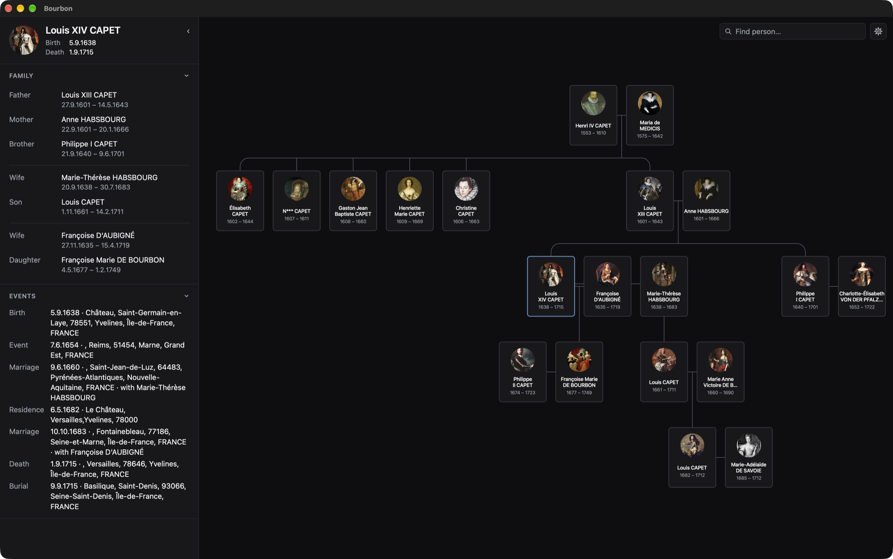

# &ensp;Sukulinja

DIY genealogy editor, early prototype — currently an hourglass family tree chart for GEDCOM files, with portraits.

Portraits come packed with the GEDCOM in a GEDZIP (`.gdz`), or are downloaded from a MyHeritage export.

Includes a House of Bourbon demo dataset.



## Setup

Requires [Bun](https://bun.sh/); the desktop app is macOS only.

```bash
bun install
bun dev       # serve the app in a browser
```

To build and install to `/Applications`:

```bash
brew install openssl   # one-time
bun cert --create      # one-time: create a self-signed code-signing cert
bun install:app        # build, sign, and copy to /Applications
```

Signing asks Apple's server for a timestamp. If it can't be reached, each file
is signed again without one, which a self-signed local build doesn't need. When
you already know you're offline, skip the wait with
`SIGN_TIMESTAMP=none bun install:app`.
